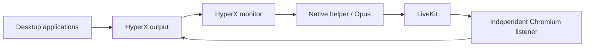

# Native audio playback investigation — 2026-11-06

This historical investigation measured whole-output monitor capture. Current game sharing uses a serial-targeted application stream. [Current same-headset workflow and measurements](native-audio.md)

**Latest status:** the user reports continued severe stuttering. See [the follow-up real desktop investigation](audio-real-desktop-investigation.md); neither this investigation nor the later synthetic-tone results establishes a listening fix.

> Follow-up: sustained testing later confirmed an additional native encoder-batching/publication-pacing defect. This earlier investigation established delivery and a feedback-capable route, not audio-quality stability. See [audio quality stabilization](audio-quality-stabilization.md) for the measured fix.

## Finding

The native audio path was working during the investigation. The user subsequently confirmed hearing audio, but described it as laggy. Their receiver showed Opus at 107.1 kb/s, 18,604 received packets, zero lost packets and positive decoded energy. Chromium's inability to return desktop audio from getDisplayMedia is independent of this native capture/publication path.

A same-output feedback route was confirmed on the actual machine: the helper captures the HyperX sink monitor, while the listening Chromium session also outputs to that HyperX sink. Native application audio is heard directly on that sink and again after the network round trip; the browser's playback is itself part of the next monitor capture. This explains delayed duplication/recirculation without packet loss. Incognito isolates browser identity and state, not the physical sound output.



Local preview suppression is correctly scoped to the exact browser participant identity. It excludes the publisher's own native helper from local playback. The incognito viewer has a different identity and is intentionally allowed to listen. Globally muting independent sessions would break the intended multi-user behavior and would not be a suitable fix.

This confirms a feedback-capable routing loop and a delayed returned copy; it does not prove every subjective stall has the same cause. A final comparison using a listening output/device outside the captured mix is needed to separate recirculation from remaining device-specific playback issues. No automatic routing change or cross-session mute was introduced.

## Evidence from the active user stream

Read-only local SFU inspection found:

- An ACTIVE browser publisher with a screen-share video track.
- An ACTIVE native helper with an unmuted `screen_share_audio` / `audio/opus` track.
- Backend-issued metadata pointing to that exact publisher identity and current screen SID.
- A separate ACTIVE guest participant.

PipeWire showed `pw-cat` receiving the HyperX `monitor_FL`/`monitor_FR` ports. It also showed the installed Chromium playback stream linked to the HyperX `playback_FL`/`playback_FR` ports. The Chromium stream volume was 1.00 and the headset volume was .81, neither muted. Spotify was paused at the first inventory, so no claim is made that Spotify was playing then; other application output and native-player test tones were available. No playback/routing/source configuration was modified.

A temporary read-only diagnostic viewer joined the **existing native stream**, using installed Chromium 156.0.8078.47 with an isolated profile and a short-lived, subscribe-only local diagnostic token. It did not replace, restart, or re-pair the user's helper. Its playback was directed only for that process to the machine's existing ALSA loopback sink to avoid introducing another feedback path. The diagnostic token and server API credentials were not printed or exposed to the application frontend.

Measured successive samples:

| Check | Observed |
| --- | --- |
| Subscription | true |
| Publisher muted | false |
| Native media track | enabled, unmuted, live |
| Audio attachment | one audio track on the element |
| Element | muted false, volume 1, paused false, readyState 4 |
| Playback clock | 2.06 → 4.06 → 6.06 seconds |
| Play rejection | none |
| Codec | audio/opus |
| Received packets | 106 → 205 → 306 |
| Received bytes | 29,275 → 57,846 → 86,522 |
| Lost packets | 0 |
| Decoded energy | .0070 → .0112 → .01294 |
| Decoded waveform RMS | .0161, .00939, .00284; non-silent |

A second sample collected buffering/concealment information: RTP jitter about 18–19 ms, average receiver jitter-buffer residence about 58–60 ms, zero concealed/silent-concealed samples, and advancing decoded energy. These samples do not establish an ongoing packet-loss or decoder-starvation failure in that viewer.

The application uses the SDK's default HTMLMediaElement playback (`webAudioMix:false`), so a suspended Web Audio context is not required to explain ordinary element playback. The probe created a separate running AudioContext solely to analyse the decoded waveform; it was not the application's playback path. It was closed on exit. LiveKit's room-wide `startAudio()` was deliberately not added: it can unmute all attached elements and would violate independent per-stream choices. Each stream continues to call its own element's `play()` inside an explicit click, preserving browser policies.

A bounded native-player tone was measured both at the actual HyperX monitor and at decoded remote audio. Approximate monitor-onset to decoded-tone detection was **168 ms**, using wall-clock spectral detection. This is a single local sample, not an acoustic latency benchmark or a guaranteed stable latency. It quantifies why a returned copy played alongside the direct source sounds delayed. Incomplete monitor probes that reported an unavailable target were discarded, not used for that measurement. No audio files were saved.

## Diagnostic and UX changes

The frontend now exposes:

- Screen-owner identity and audio-publisher identity, including native helper association.
- Subscription, publication enabled/muted state, exact media-element attachment.
- Actual element mute, volume, pause, readiness, clock, output device and media error.
- Native media-track enabled/muted/live state and explicit HTML-element playback path.
- Received bytes, jitter, interval jitter-buffer residence, concealed samples and interval decoded-energy change, alongside existing codec/bitrate/packet counters.
- The actual rejection reason when an explicit play request fails.

Interval energy avoids interpreting an old positive total as proof of current sound. Buffering/rates reset on track/counter discontinuities; unsupported fields remain unavailable. Jitter-buffer residence is not total end-to-end latency. Browser-level tab mute, physical hearing and global OS mixer decisions remain separate checks.

A native audio row explains same-output recapture and the need for a different listening output/device. Publisher status now explicitly says its preview alone is silent, rather than claiming that all local feedback is disabled. No security changes, microphone fallback, audio transport rewrite, automatic output change, or video optimization were made.

## Safe manual confirmation

1. Keep the native helper on the intended output monitor. On the publisher, local native preview remains silent.
2. In the independent listener, use a **different existing output device** from the captured sink, or an existing second machine. If testing on this machine, make any per-application/per-stream output selection deliberately; the application does not change global routing.
3. Play a recognizable native application sound, unmute only the intended publisher and check volume. Do not use the same monitored sink for listener playback during this comparison. Verify delayed repetition disappears with the recirculation route removed.
4. If delay/choppiness remains, compare increasing bytes/packets and interval energy with jitter-buffer/concealment counters and actual element state. Capture those values while the issue occurs, rather than relying on publication status or historic energy totals.
5. If the element is playing with non-silent decoded audio but nothing is heard, inspect the tab/site mute and the selected output's per-app mixer and physical device. If play rejects, use the explicit per-stream retry and record its error; do not disable autoplay protections.

References: [LiveKit subscriptions and playback](https://docs.livekit.io/transport/media/subscribe/), [MDN autoplay policy and explicit playback](https://developer.mozilla.org/en-US/docs/Web/Media/Guides/Autoplay).

## Validation of the diagnostic update

```text
npm --prefix frontend test
Test Files 8 passed (8)
     Tests 67 passed (67)

npm --prefix frontend run build
# TypeScript and Vite production build passed; existing bundle-size warning remains.

LIVEKIT_INTEGRATION_URL=http://127.0.0.1:7880 go test -race ./...
# Backend config, HTTP and room tests passed, including live SFU integration.

# From native-audio/
go test -race ./...
go vet ./...
# Both passed; native helper transport/capture implementation was unchanged.
```

New regressions cover native owner identity versus local-preview suppression, correct identity association in an independent viewer, independent listener consent despite a same-computer warning, actual element attachment/mute/volume/pause diagnostics, zero-loss jitter/buffer measurements, counter resets, and publication of the actual play-rejection reason. Existing autoplay, lifecycle, mute and volume tests remain in place.

The new built frontend was loaded only into isolated test contexts by asset interception (`E2E_BUILT_FRONTEND=1`), preserving the live publisher's existing frontend. Actual APIs, origins, SFU, SDK subscription and media transport remained real.

```text
E2E_BUILT_FRONTEND=1 NATIVE_AUDIO_SINK=alsa_output.usb-HP__Inc_HyperX_Cloud_II_Wireless_0-00.analog-stereo \
PULSE_SINK=alsa_output.platform-snd_aloop.0.analog-stereo \
npm run test:e2e -- audio.spec.ts
3 passed (12.9s)

E2E_BUILT_FRONTEND=1 E2E_BROWSER=firefox \
npm run test:e2e -- audio.spec.ts -g 'generated Opus|native pairing'
2 passed (7.5s)

docker compose build frontend
Image whiterun-live-frontend Built
```

The Chromium run included two actual native Go helpers capturing the selected monitor and real browser reception/decoding, with test playback isolated from that sink. Generated browser capture tests remain explicitly separate from actual PipeWire capture. The native pairing test also verifies the independent listener has one attached native audio element while the publisher has no local audio renderer. Neither these tests nor decoded energy alone assert physical hearing in the user's existing incognito tab.

Temporary probe scripts were removed from the repository. No audio recordings, global audio-routing changes, browser security overrides, microphone fallback, backend permission changes, or video optimization were introduced. The frontend-only image was prepared; applying it can reload the active publisher, so rollout is a separate final step.

## Approved frontend rollout

The user approved the frontend reload after the image/tests were complete. Applied only:

```text
docker compose up -d --no-deps --wait --wait-timeout 120 frontend
Container whiterun-live-frontend-1 Healthy

npm run test:e2e -- audio.spec.ts -g 'native pairing'
1 passed (1.3s)
```

Backend and LiveKit remained running; existing invitation capabilities were preserved. The deployed frontend now exposes the expanded diagnostics, explicit per-session preview wording and same-output feedback warning. Temporary diagnostic viewer sessions exited, and temporary probe scripts were removed. No host audio routing was changed. The remaining manual check is listening with the receiver outside the captured output mix, then investigating any residual issue with the new interval/element diagnostics.
