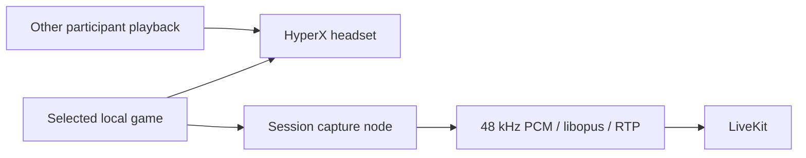

# Native PipeWire audio — same-headset isolation

The default local room connects one game stream when you approve an audio-enabled screen share. The [player guide](local-player.md) covers automatic selection, changing the source, and listening on one headset. The manual pairing procedure below applies to invitation rooms and diagnostics.

## Release gate

One physical headset per participant is the supported topology. Release requires clean listening on the HyperX Cloud II Wireless during simultaneous game sharing. The two-browser hardware exercise below provides digital measurements. Human listening is pending.

## Architecture

Alice and Bob each keep their existing physical headset and default output. The helper taps one explicitly selected local application's stereo output ports before the physical sink mixes remote playback into them.



There is no connection from the headset monitor or remote browser stream to the capture node. Each participant runs the same architecture. The game continues through its original playback links, so no relay/loopback is needed to hear it locally. Remote participants retain independent mute/volume controls. The frontend unsubscribes the owner's helper audio by participant identity, including during screen replacement, and attaches audio elements only for remote owners. Another participant with the same display name is unaffected.

After screen-bound authorization and explicit `--start --application SERIAL` consent, the helper opens a named stereo recorder with `pw-cat --record --target SERIAL`. WirePlumber resolves the game stream by its live PipeWire object serial. The session sets `node.dont-move`, `node.dont-fallback`, `node.dont-reconnect`, and `stream.dont-remix`. The direct-target probe on this workstation preserved both original headset link IDs and destroyed the recorder when its target disappeared. [WirePlumber linking policy](https://pipewire.pages.freedesktop.org/wireplumber/policies/linking.html)

Before submitting PCM to libopus, the helper reads the actual graph and requires exactly one FL and one FR link from the selected stream into its own recorder. It checks the node serials, channel ports and incoming links again on each lease renewal. This detects graph changes at inspection time. Local applications with sufficient PipeWire permissions can still edit links between inspections. The session's lifetime follows the recorder process. Parent-death signaling covers an abruptly killed helper.

## Alternatives evaluated

| Approach | Isolation and tradeoff |
| --- | --- |
| Physical headset monitor | Mixes game and remote playback; unsuitable for the same-headset product path. Available only with explicit `--allow-mixed-monitor` diagnostic consent. |
| Dedicated virtual sink with selected applications moved into it and looped to headset | Can isolate playback, but requires stream moves, an additional playback path, restoration bookkeeping, and handling app exits/device changes. Not needed for the supported direct application tap. No virtual sink is installed. |
| Exclude selected browser streams from a whole-output mix | Fragile when browser processes/tabs and streams change; excluding a browser can also exclude a browser game. Not used. |
| Explicit application output-port tap | Tested on this host. Leaves normal playback intact and excludes unrelated streams by construction. Chosen for local stereo game/application capture. |

This release supports **one FL/FR stereo application stream per helper**. Known browser/player mixes, communication streams and virtual filter outputs are excluded using stream and client metadata; that classification is a conservative usability guard, not cryptographic provenance. A user must select the intended local game. Browser games sharing a stream with remote playback, mono/surround layouts, apps with multiple independently needed audio nodes, and explicit remote mixing/relay remain unsupported. Those cases must not silently fall back to whole-monitor capture. Microphone sources are not accepted and would need their own consent and publication path in a future implementation.

## Build and use

Run as the desktop user on Arch/PipeWire/Hyprland. Dependencies: Go with cgo, `opus`, `pkgconf`, a C compiler, WirePlumber, `pw-dump` and `pw-cat`. FFmpeg is only used by diagnostic fixtures.

```sh
cd native-audio
go build -o whiterun-audio .
./whiterun-audio --version
./whiterun-audio --list-applications
```

Start the game and make it produce sound before listing. The first column is a live `object.serial`, followed by application/node names. It is not a permanent identifier. Start real screen sharing, click **Pair native audio helper**, then run:

```sh
./whiterun-audio --start --application SERIAL --timing-json /tmp/whiterun-game-NEW.jsonl
```

Replace `SERIAL` with the selected game's number and paste the one-time pairing JSON into stdin. This is explicit consent to add the session capture links for that application. Pairing, listing, or joining a room alone does not start capture. If the game recreates its audio stream, the helper stops: list and explicitly reselect/re-pair. It does not follow a reused node ID or automatically capture a new application.

Alice and Bob each publish their game this way, then unmute only the other participant in their normal browser. Both hear local game audio directly and remote audio through their existing headset. Stopping sharing, leaving, lease revocation, Ctrl-C, or helper termination releases the tap. No output switch is part of this workflow.

The helper keeps the existing PCM → in-process libopus → 20 ms RTP pacing pipeline. No new resampler, jitter-buffer tuning, encoder rewrite or video optimization was introduced. PipeWire performs any format/rate adaptation needed by the selected stream. `--timing-json` contains metadata only: executable identity, selected source/capture serials, pipe backlog, PCM processing, encoding, RTP pacing and RTCP reports, not audio or credentials.

## Authorization and lifecycle

A publisher join returns a random native-control capability, held only in browser memory; viewers receive no usable control capability. The backend stores hashes and room/identity associations with bounded capacity. Existing invitation/operator authorization is unchanged.

`POST /native-audio/sessions` requires that capability and an actual, current screen track SID confirmed through the backend's scoped LiveKit API client. At most one active helper session per browser participant is allowed. `POST /native-audio/claim` exchanges the single-use code atomically for a different random `native-audio-*` identity, an initial 30-second LiveKit join token, and a separate lease capability. The helper never sees LiveKit API credentials, operator keys, room invitations, or the browser's control capability.

Its grants allow only `screen_share_audio`, with subscription, data publishing, and metadata mutation disabled. The token's backend-established metadata binds `nativeAudioOwner` and `nativeAudioScreen`; names supplied by clients do not establish ownership. These permissions authorize the declared source type, not cryptographic attestation of a physical device. The shipped helper defaults to an explicitly selected local application stream. Device monitors require a diagnostic opt-in.

The tab opens one authenticated `POST /native-audio/{session}/watch` response and displays the pairing code after the first heartbeat. This response carries session status at two-second intervals. The backend requires an attached owner before issuing helper credentials. Loss of the owner connection revokes the session even while LiveKit retains the screen for reconnection. The existing screen checks and helper lease also apply. Re-pair explicitly if the owner connection breaks.

The frontend associates helper audio only with the exact currently published screen of that owner. It renders one audio element per remote owner. The pairing UI is available with video-only sharing. The browser audio option requests tab audio with own-document audio restriction and keeps local playback enabled. It discards returned audio from a window, monitor, unknown surface, or tab without a confirmed restriction. Receivers also deduplicate legacy simultaneous publications by owner. Local helper audio is never attached. Screen replacement does not accidentally inherit an old helper. Browser autoplay rejection/retry and per-owner volume preferences use the existing renderer.

The helper renews a 10-second lease every two seconds. The backend checks the owner's screen through LiveKit and monitors sessions every second. Screen removal, owner departure, explicit stop, expired pairing/lease, or failed ownership validation revokes the lease and removes the helper participant. Browser stop/unmount also sends a keepalive stop request. Backend/API failure causes the helper to exit rather than continue without authorization. Ordinary browser signaling recovery retains capture where the screen remains published; a full republish with a different SID requires explicit re-pairing.

**Self-hosted token limitation:** removing a participant does not cryptographically invalidate its cached LiveKit JWT. The initial join token lasts 30 seconds, and LiveKit may issue longer refreshed reconnect tokens. The shipped helper obeys lease revocation and terminal disconnect and does not reconnect after being removed; no new token can be claimed from a revoked session. This is application-enforced capture cleanup, not an assertion of Cloud-style instantaneous JWT revocation. A modified client holding a still-valid token is outside that cooperative shutdown guarantee. Internet exposure would need a stronger session admission/revocation design; existing local development credentials remain isolated.

On unavailable/removed/replaced applications or devices, PipeWire loss, encoder end, or a five-second PCM stall, the helper stops and requires another explicit start. It never switches to the default sink or microphone. This deliberately favors consent and deterministic source selection over seamless device migration. Normal SDK reconnection uses the same live capture; terminal disconnect tears down children and releases resources.


## Automated validation and listening gate

On 2026-11-22 the three-minute run inspected the graph 339 times. Each browser rendered one remote signal to the HyperX. On Alice's output the strongest own-tone measurement was 58.9 dB below Bob's tone. On Bob's output it was 50.6 dB below Alice's. After the five-second startup window each receiver recorded zero additional lost packets or concealed samples. At the end of startup the concealed-sample counts were 576 and 655 respectively. Both senders advanced 960 RTP ticks per packet. The longest measured send interval was 21.64 ms rounded up. Doubling Alice's slider produced 2.006 times her previous level and 0.998 times Bob's previous level. Closing Bob's browser took 3.35 seconds from initiating close to verifying helper exit. [Measured playback, graph and cleanup results](same-headset-render-results.json)

The harness uses two real browser sessions (Chromium and Firefox), two foreground helpers and the local LiveKit SFU. Each generated game stream and both browser renderers play through the same physical HyperX. This deliberately puts all four sources in the same hardware mix. The evidence describes two logical endpoints on one workstation. The synthetic screen tracks exercise the normal screen-publishing and pairing lifecycle.

Run from the repository root with the local stack up and the current backend/frontend installed. The helper build command above produces the executable used by this test.

```sh
npm --prefix frontend run build
SAME_HEADSET_SINK=alsa_output.usb-HP__Inc_HyperX_Cloud_II_Wireless_0-00.analog-stereo \
SAME_HEADSET_SECONDS=90 SAME_HEADSET_CLEANUP=owner-disconnect \
node native-audio/scripts/same-headset-run.mjs
```

The fixture plays quiet 440 Hz and 997 Hz signals. Test-specific Pulse properties identify the exact browser streams. Test meters tap those outputs at their PipeWire ports after browser playback gain. They keep numeric levels for both channels, discard PCM, and never sample the headset monitor. Headless Chromium runs with audio enabled. The harness checks the following:

- Both original game-to-headset links keep their serials. Each game contributes two additional links to its own helper. Both browsers' playback links terminate at the selected headset.
- Exactly one rendered stream per listener carries the remote tone. Every steady-state 100 ms block is measured in both channels, with a 20 ms RMS minimum to detect dropouts. The foreign tone must stay at least 40 dB below the wanted tone.
- Receiver packet and playout counters advance on every poll. The test rejects new packet loss or concealment after the first five seconds and checks consecutive RTP sequence numbers and 960-tick Opus timestamps.
- Doubling Alice's remote volume must approximately double the level in her actual renderer while Bob's stays within 10%. Mute and independent sliders for multiple remote owners also have browser regression coverage.
- Alice stops sharing normally. Set `SAME_HEADSET_CLEANUP` to `owner-disconnect`, `source-end` or `helper-killed` for Bob. The harness waits for process exit, checks that both capture nodes disappeared, verifies surviving local playback links, and compares the default output before and after.

Each run writes `run.json`, per-helper timing JSONL, receiver diagnostics and windowed rendered levels in the printed results directory. The earlier decoded-track measurements are retained as a historical baseline. [Prior decoded-track measurements](same-headset-results.json)

### Listening sign-off

Use two participants with a headset each on a reachable, authorized room. The bundled localhost Compose network serves this workstation. The co-located automated test plays both participants' local and remote sounds on the same headset, so use separate endpoints for a listening verdict.

1. On each machine start a real game, list its application stream, share the desktop, and pair that game's serial. Listen to the local game with the remote participant muted.
2. Unmute each other. Take turns making short, identifiable sounds, then play simultaneously for several minutes. Listen for a second delayed copy of your own cue, an echo that grows, missing sounds or repeated fragments.
3. Have one player pause their game while the other continues. The paused player's publication should contain none of what they are hearing from the remote player. Adjust each remote volume and verify that local game volume stays steady.
4. Stop one share and close the other room. Both local games should continue through the same headsets. Record browser versions, duration, which participant heard any issue, and timestamps. The release gate remains open until the user confirms clean HyperX listening.
